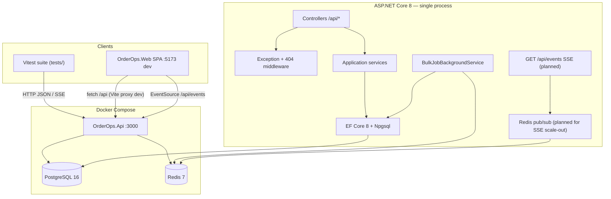
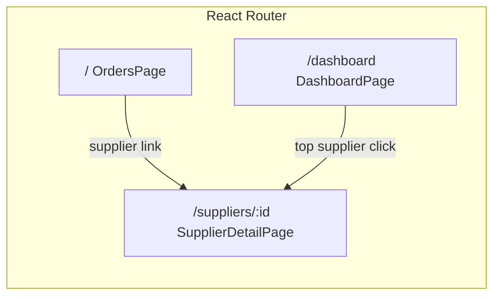
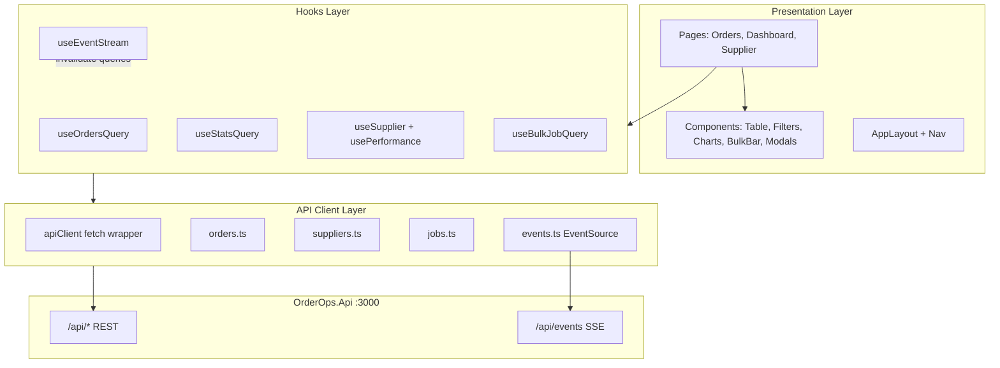
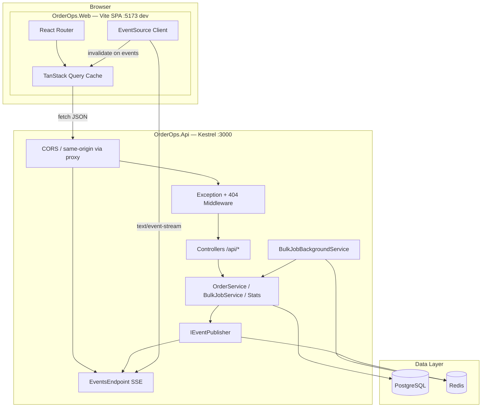
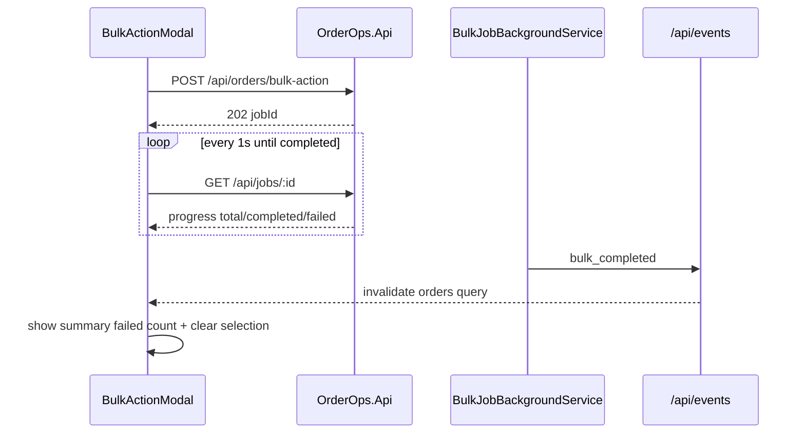

# OrderOps — System Architecture

Procurement order-management system for the Reeco take-home assignment. This document describes the architecture for Part 1 (README sections 1.1–1.7), the **OrderOps.Web** React SPA (Part 2), what is **implemented today**, and the **reasoning** behind each major decision.

**Spec authority:** when README and automated tests disagree, **tests win** (`tests/*.test.ts`, `tests/expected-values.json`).

---

## 1. Goals and constraints

| Goal | Implication |
|------|-------------|
| Correctness under concurrency | Optimistic locking on orders; Redis locks for overlapping bulk work |
| Query performance at ~50k orders | PostgreSQL indexes, selective joins, Redis-backed stats cache |
| Runnable MVP in one command | Docker Compose: Postgres + Redis + single API container on port **3000** |
| Verifiable incrementally | External Vitest suite drives implementation order (basic → filter → agg → …) |
| API-first delivery | JSON REST + SSE on port **3000**; separate React SPA for Part 2 UI |

The system is a **monolithic API process** for assignment scope. Internal boundaries (service interfaces, DTOs, planned workers) allow bulk processing, caching, and pub/sub to grow without changing the HTTP contract.

---

## 2. System context



| Component | Status |
|-----------|--------|
| API ↔ PostgreSQL | Implemented |
| CRUD, filtering, CSV import | Implemented (1.1, 1.2) |
| Stats, supplier performance, anomalies | Implemented (1.3, 1.4) |
| Bulk jobs + background worker | Implemented (1.5) |
| Redis locks + stats cache | Implemented when Redis configured (1.6) |
| SSE `/api/events` | Planned (1.7); frontend client wired |
| OrderOps.Web React SPA | Implemented (Part 2) |

---

## 3. Solution structure

```
src/
├── OrderOps.Api/                 # HTTP host — controllers, middleware, model binding
├── OrderOps.Infrastructure/      # EF Core, import, services, bulk worker, caching
├── OrderOps.Import/              # CLI for manual CSV import
└── OrderOps.Web/                 # Vite + React 18 + TypeScript SPA (Part 2)
    ├── vite.config.ts            # dev proxy /api → http://localhost:3000
    └── src/
        ├── api/                  # typed fetch layer (orders, suppliers, jobs, events)
        ├── types/                # DTOs — snake_case to match API JSON
        ├── routes/               # react-router-dom v6
        ├── pages/                # Orders, Dashboard, Supplier detail
        ├── components/           # table, filters, charts, bulk modals, layout
        ├── hooks/                # React Query + SSE invalidation
        └── lib/                  # formatters, query-string builders
```

### Why Api + Infrastructure?

| Choice | Reasoning |
|--------|-----------|
| **Api** owns HTTP | Controllers stay thin; JSON naming, query binding, and status codes stay at the edge. |
| **Infrastructure** owns I/O | EF Core, CSV import, Redis, and background work sit behind interfaces (`IOrderService`, etc.). |
| **No separate Domain project** | Assignment scope is bounded; extra project adds ceremony until anomaly/bulk rules justify it. |
| **OrderOps.Import CLI** | Reuses `CsvImporter` without the web host — useful for local re-seed and debugging. |

This is a **pragmatic layered monolith**: one deployable unit, clear dependency direction (Api → Infrastructure → database).

---

## 4. Architectural decisions

### 4.1 ASP.NET Core 8 on port 3000

**Decision:** Single Kestrel host at `http://+:3000`.

**Why:** Tests target `localhost:3000`; one container satisfies the MVP. Kestrel handles assignment load without nginx.

**Tradeoff:** REST, SSE, and background work share one process. Production would add TLS termination, health probes, and horizontal scaling behind a load balancer.

---

### 4.2 PostgreSQL 16 as system of record

**Decision:** All relational data in PostgreSQL via EF Core 8 + Npgsql.

**Why:**

- 50k orders with filters and aggregations are well within PostgreSQL with proper indexes.
- `pg_trgm` supports product name search (`ILIKE` + GIN index).
- EF migrations keep Docker and local schema aligned.

**Tradeoff:** Heavy aggregations (`/api/orders/stats`) may need raw SQL or Dapper if LINQ is too slow — indexes and optional Redis cache are the first lever.

**Indexes (initial migration):**

| Index | Query pattern |
|-------|----------------|
| `(status)`, `(status, created_at)` | Status filter, filtered sort |
| `(supplier_id)` | Supplier filter, joins |
| Partial `(warehouse) WHERE NOT NULL` | Warehouse filter |
| `(created_at)`, `(total_price)` | Date range, `min_total`, sort |
| GIN `pg_trgm` on `products(name)` | `?search=` |
| `(category_id)` on products | Category filter via closure table |

---

### 4.3 EF Core + composable `IQueryable`

**Decision:** EF for CRUD, migrations, and filter pipelines; parameterized queries only.

**Why:**

- `IQueryable` composition keeps filters in one pipeline without SQL string concatenation (security tests expect safe handling of malicious `status` values).
- `ExecuteUpdateAsync` on PATCH avoids loading entities and applies version checks in SQL.
- `AsNoTracking()` on reads reduces overhead for list endpoints.

**Tradeoff:** N+1 and translation limits — mitigated by explicit `Select` projections and conditional joins (e.g. products only when `search` is set).

---

### 4.4 Category hierarchy: closure table

**Decision:** `category_descendants (ancestor_id, descendant_id)` built at import; cycle detection via DFS when expanding descendants.

**Why:**

- `GET /api/products?category=` must include child categories without a recursive CTE on every request.
- CSV contains intentional cycles (`cat_150` / `cat_151` / `cat_152`); expansion must not loop infinitely.

**Tradeoff:** Storage and import-time work exchanged for O(1) ancestor lookups at read time.

---

### 4.5 CSV import: full fidelity, idempotent startup

**Decision:** Load all CSV rows; startup runs migrate → import only if `orders` count ≠ 50,000.

**Why:**

- Anomaly and security tests depend on edge-case rows (XSS in `notes`, bad quantities, timestamp quirks).
- Skipping re-import when data exists keeps container restarts fast.
- Deferred FK on `categories.parent_id` allows cyclic parent references to load before closure build.

**Load order:** categories → closure table → suppliers → products → orders.

---

### 4.6 snake_case at the HTTP boundary

**Decision:** `SnakeCaseNamingPolicy` for JSON; `SnakeCaseQueryValueProvider` maps query keys like `supplier_id` → `SupplierId`.

**Why:** Tests and README use snake_case; C# models stay PascalCase; conversion is centralized.

**Tradeoff:** Custom value provider vs per-property `[FromQuery(Name)]` — scales as filter parameters grow.

---

### 4.7 Unified error envelope

**Decision:** `ExceptionHandlingMiddleware` maps domain exceptions to `{ "error", "code" }` with correct HTTP status.

**Why:** Tests assert specific `error` strings on 404/409/400; controllers avoid repetitive try/catch.

---

### 4.8 Order list pipeline

**Decision:** `OrderListQuery` → filter → sort → `CountAsync` + paginated projection.

**Notable behaviors:**

- **Conditional product join:** `products` joined only when `search` is present (separate EF projection expressions).
- **Default sort:** `created_at`, then `id` when `sort` omitted — chronological default and stable pagination.
- **Date bounds:** `date_from` / `date_to` parsed to inclusive UTC day boundaries in `OrderQueryDateParser`.

**Tradeoff:** Two DB round-trips per list (`COUNT` + page) — standard for offset pagination; cursor pagination would be a future optimization.

---

### 4.9 Optimistic concurrency on PATCH

**Decision:** `orders.version` concurrency token; conditional update; 409 on conflict or cancelled order.

**Why:** Concurrent PATCH tests require exactly one winner without row-level read locks on the hot path.

**Planned:** Publish `order_updated` SSE event after successful PATCH (section 1.7).

---

### 4.10 Redis

| Use | Mechanism | Rationale |
|-----|-----------|-----------|
| Bulk overlap | `SET bulk:order:{id} NX EX 30` | Same order not processed twice across overlapping jobs |
| Stats cache | Key `stats:v1`, TTL ~60s | Meet p95 for `/api/orders/stats`; invalidate on status change |
| Real-time | Pub/sub channel `events` | Fan-out to SSE subscribers (see single-process note below) |

**Why Redis over in-memory only (locks):** Overlapping bulk jobs must not double-process the same order. An in-memory lock per order ID works on **one Kestrel process**; Redis `SET NX` is required when multiple API instances (or separate worker processes) can touch the same order concurrently.

**Pub/sub and the single-container MVP:** The assignment runs **one API container** on one Kestrel host. For that deployment, SSE does **not** strictly require Redis pub/sub — an in-memory registry of open SSE connections, fed directly when PATCH or the bulk worker updates an order, is enough to pass realtime tests.

We still plan Redis pub/sub for **future expansion**:

| Single process (today) | Multiple API instances (later) |
|------------------------|--------------------------------|
| Publisher and SSE connections live in the same process | PATCH/bulk on instance A; SSE client on instance B |
| In-memory fan-out is sufficient | Instance A cannot push to B’s connections without a shared bus |
| Optional: skip pub/sub for minimal MVP | Redis channel `events` delivers messages to every subscriber process |

Using pub/sub from the start keeps publishers (order update, bulk completion) decoupled from SSE connection management and avoids a redesign when horizontal scaling is added. It also reuses Redis already provisioned in Compose for locks and stats cache.

**Current state:** `DependencyInjection.cs` registers `IConnectionMultiplexer`, `IBulkOrderLockService`, and `IStatsCache` when a Redis connection string is configured; falls back to in-memory implementations for local dev without Redis.

---

### 4.11 Bulk operations

**Decision:** HTTP **202** in &lt;500ms; `jobs` row + `Channel<BulkJobMessage>` + `BulkJobBackgroundService`; poll `GET /api/jobs/:id`.

**Why:** Tests measure acceptance latency, not batch completion time. Built-in `BackgroundService` avoids external queue infrastructure for a single-node MVP.

**Actions:** `approve`, `reject`, `flag` (append to notes, idempotent).

**Status:** Implemented — `BulkJobBackgroundService` processes jobs from `IBulkJobQueue`; clients poll `GET /api/jobs/:id`.

---

### 4.12 Real-time: SSE (planned — endpoint not yet exposed)

**Decision:** `GET /api/events?supplier_id=optional` — native SSE, not SignalR.

**Why:** One-way notifications; test client explicitly supports SSE fallback.

**Format:** `data: {"type":"order_updated","data":{...}}\n\n`

**Transport to clients:** SSE endpoint maintains per-connection writers; optional `supplier_id` filter applied before writing events. Events are sourced via Redis pub/sub (section 4.10) so publishers do not hold references to HTTP connections — important for multi-instance expansion; on a single Kestrel process, an in-memory bus would also work.

---

### 4.13 DTOs and pagination

**Decision:** `OrderOps.Infrastructure.Dtos` for API records; lists return `{ data, total, limit, offset }`.

**Why:** EF entities never serialized to clients; `OrderListQuery.Normalize()` centralizes limit/offset policy (default 20, max 1000).

---

### 4.14 Testing

**Decision:** Vitest integration tests against live API; optional xUnit for pure logic (anomaly severity, query builders).

**Why:** Assignment ships the test suite as the contract; integration tests catch binding, SQL, and HTTP together.

---

## 5. Deployment

### Docker Compose

```
postgres:16-alpine  → persistent volume pgdata
redis:7-alpine
api                 → build from src/OrderOps.Api/Dockerfile, port 3000
```

API `depends_on` postgres and redis with `service_healthy`. Data volume `./data:/app/data:ro` for CSV import.

### Startup (`Program.cs`)

1. `Database.MigrateAsync()`
2. If `Import:RunOnStartup` → `CsvImporter.ImportIfNeededAsync()`
3. (Planned) Register and start `BulkJobBackgroundService`
4. Listen on port 3000

### Dockerfile

Multi-stage: `sdk:8.0` build → `aspnet:8.0` runtime; embeds `data/` for container import path `/app/data`.

### Local dev (API outside Docker)

```bash
docker-compose up -d postgres redis
cd src/OrderOps.Api && dotnet run
cd tests && npm test
```

### Local dev (full stack — API + SPA)

Two terminals; the Vitest suite still targets the API on `:3000` only.

```bash
# Terminal 1 — infrastructure + API
docker-compose up -d
cd src/OrderOps.Api && dotnet run    # http://localhost:3000

# Terminal 2 — frontend (Vite dev server proxies /api → :3000)
cd src/OrderOps.Web && npm install && npm run dev   # http://localhost:5173
```

The SPA uses a relative `/api` base URL. Vite's dev proxy avoids CORS for local development. Production static hosting of `OrderOps.Web/dist` requires either the same-origin integrated SPA in the API container (`wwwroot`) or a narrow CORS policy on the API for the static host origin.

---

## 6. Implementation status

| Section | Capability | Status |
|---------|------------|--------|
| 1.1 | CRUD, PATCH concurrency | Done |
| 1.2 | Filters, sort, search | Done |
| 1.3 | Stats, supplier performance | Done |
| 1.4 | Anomalies | Done |
| 1.5 | Bulk jobs | Done |
| 1.6 | Redis locks, stats cache | Done (Redis or in-memory fallback) |
| 1.7 | SSE events | Planned |
| Part 2 | OrderOps.Web React SPA | Done |

---

## 7. Cross-cutting concerns

**Observability:** `ILogger` for migrations, import, unhandled 500s. Planned: bulk progress, SSE connection metrics.

**Security (assignment scope):** Parameterized queries; status enum validation; bulk size limits; JSON error bodies; raw `notes` preserved (not HTML-sanitized).

**Scale-out path:** Horizontal API replicas + Redis locks/pub/sub; stats materialization or read replicas if order volume grows beyond 50k.

---

## 8. Key files

| Area | Path |
|------|------|
| Host | `src/OrderOps.Api/Program.cs` |
| Controllers | `src/OrderOps.Api/Controllers/` |
| Query binding | `src/OrderOps.Api/ModelBinding/SnakeCaseQueryValueProvider.cs` |
| Middleware | `src/OrderOps.Api/Middleware/` |
| Services | `src/OrderOps.Infrastructure/Services/` |
| DTOs | `src/OrderOps.Infrastructure/Dtos/` |
| EF / migrations | `src/OrderOps.Infrastructure/Data/` |
| Import | `src/OrderOps.Infrastructure/Import/CsvImporter.cs` |
| DI | `src/OrderOps.Infrastructure/DependencyInjection.cs` |
| Status constants | `src/OrderOps.Infrastructure/Common/OrderStatuses.cs` |
| Bulk worker | `src/OrderOps.Infrastructure/Workers/BulkJobBackgroundService.cs` |
| Bulk queue / locks | `src/OrderOps.Infrastructure/Bulk/` |
| Stats cache | `src/OrderOps.Infrastructure/Caching/` |
| Frontend host | `src/OrderOps.Web/vite.config.ts` |
| Frontend routes | `src/OrderOps.Web/src/routes/index.tsx` |
| Frontend API client | `src/OrderOps.Web/src/api/` |
| Frontend hooks | `src/OrderOps.Web/src/hooks/` |
| Frontend pages | `src/OrderOps.Web/src/pages/` |

---

## 9. Frontend architecture

### 9.1 Separation rationale

**OrderOps.Web** is a **separate SPA**, not embedded in the API build for day-to-day development.

| Factor | Separate SPA | Integrated SPA (API serves `dist/`) |
|--------|--------------|-------------------------------------|
| Automated tests (115 pts) | API on `:3000` unchanged; zero risk to test pipeline | Dockerfile/build changes; SPA fallback must not intercept `/api/*` |
| Part 1 vs Part 2 boundary | API remains a standalone product; Swagger at `:3000` | UI and API share deploy artifact |
| Dev experience | Vite HMR + proxy is fast | Rebuild/restart API to see UI changes |

The API `Program.cs` optionally serves a pre-built SPA from `wwwroot` when present (Docker image path); local Part 2 development uses the Vite dev server on port **5173** with a proxy to **3000**.

### 9.2 Tech stack

| Layer | Choice | Role |
|-------|--------|------|
| Build | Vite 8 | Fast dev server, HMR, production bundle |
| UI | React 19 + TypeScript | Component model, typed props and DTOs |
| Routing | react-router-dom v7 | Three routes under `AppLayout` |
| Server state | TanStack Query v5 | Caching, loading/error, invalidation on SSE |
| Charts | recharts | Dashboard and supplier performance charts |
| Styling | CSS modules | Scoped styles; no heavy UI kit |

### 9.3 Route map



| Route | View | Primary data |
|-------|------|--------------|
| `/` | Orders table | `GET /api/orders` with URL-synced filters, sort, pagination |
| `/dashboard` | Analytics dashboard | `GET /api/orders/stats` |
| `/suppliers/:id` | Supplier detail | `GET /api/suppliers/:id`, `…/performance`, filtered orders |

### 9.4 Layered design



**Key patterns:**

- **URL as source of truth for filters** — `useOrderListParams` syncs filter state to `searchParams` so refresh and share preserve the orders view.
- **Typed errors** — `ApiClientError` parses `{ error, code }` from non-2xx responses; 409 on PATCH triggers optimistic rollback.
- **No global Redux** — React Query plus local UI state (row selection, modal open) is sufficient.
- **Snake_case types** — TypeScript interfaces match API JSON (`supplier_id`, `total_price`, etc.) without mapping boilerplate.

### 9.5 Data-fetching and realtime

| Hook | Query key / interval | Invalidation |
|------|---------------------|--------------|
| `useOrdersQuery` | `['orders', query]` | SSE `order_updated`, `bulk_completed`; manual after PATCH |
| `useStatsQuery` | `['stats']` | SSE `bulk_completed` |
| `useBulkJobQuery` | `['jobs', jobId]` — poll every **1s** until terminal | SSE `bulk_completed` |
| `useEventStream` | N/A (long-lived `EventSource`) | Invalidates orders + stats on relevant events |

`AppLayout` opens a global SSE connection; on the supplier detail route it passes `?supplier_id=` so server-side filtering can scope events when the endpoint is live.

Reference implementations for API contracts: `tests/helpers/api.ts` (fetch wrapper), `tests/helpers/events-client.ts` (SSE parsing).

### 9.6 View responsibilities and UX states

**Orders (`/`):** Filter bar (status, priority, supplier, warehouse, date range, search), sortable paginated table, inline status PATCH with 409 handling, multi-select bulk bar → confirm modal → `POST /api/orders/bulk-action` → progress modal with job polling. States: skeleton rows (loading), error banner with retry, empty "No orders match filters".

**Dashboard (`/dashboard`):** Summary cards (`total_orders`, `total_revenue`, `avg_order_value`); charts for status distribution, monthly volume trend, top suppliers. States: chart skeletons, error card.

**Supplier detail (`/suppliers/:id`):** Header (name, rating, country, aggregates), performance metrics + monthly trend chart, paginated order history. 404 → dedicated not-found state.

**Bulk completion:** Progress modal shows `completed` / `failed` / `total` from `GET /api/jobs/:id`; selection clears on terminal status; SSE provides eventual consistency across tabs.

**Security (assignment scope):** Order `notes` rendered as plain text only — no `dangerouslySetInnerHTML`.

---

## 10. Low-level design (full stack)



`EventsEndpoint`, `IEventPublisher`, and Redis pub/sub fan-out are **planned** for section 1.7; the diagram shows the target wiring. Today the frontend `useEventStream` hook is ready and will invalidate React Query caches once `/api/events` is live.

### Bulk action sequence



HTTP **202** returns within the test budget; the UI polls job status at 1-second intervals until `completed` or `failed`, then displays a summary. When SSE is available, polling and push complement each other — polling drives the progress bar; SSE refreshes list and stats for other clients and tabs.

---

## 11. Summary

OrderOps is a **full-stack procurement system**: a **layered ASP.NET Core 8 monolith** on port **3000** plus a **separate React SPA** (`OrderOps.Web`) for Part 2. PostgreSQL holds relational data; Redis provides bulk locks and stats caching (with in-memory fallbacks). The API exposes **snake_case JSON REST**, seeds from CSV with full data fidelity, and uses **index-aware EF queries** for list endpoints. **Optimistic locking** handles concurrent PATCH; **Redis SET NX** prevents bulk overlap across jobs. **Fast 202 + `BulkJobBackgroundService`** handles async bulk work; **SSE** (`GET /api/events`) completes the real-time story once wired. The frontend uses **TanStack Query**, **URL-synced filters**, job polling, and an **EventSource** client prepared for SSE invalidation — runnable in two terminals without affecting the API-only Vitest suite.
